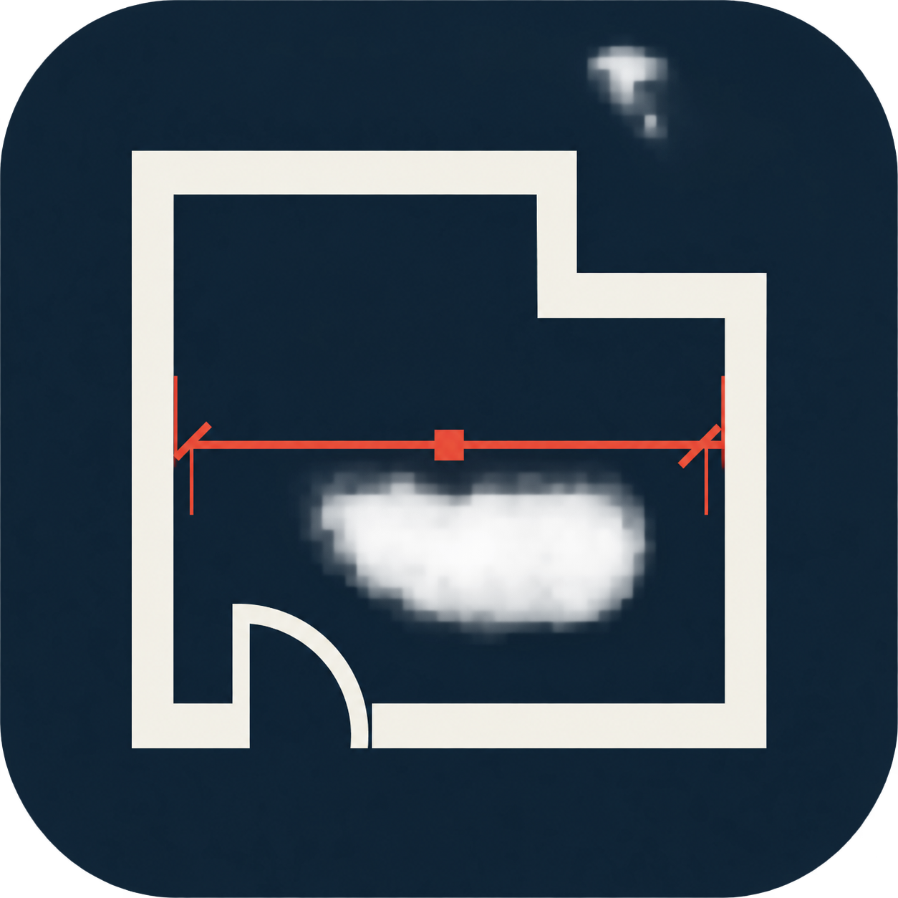

<div align="center">



<h1>LaserSketch</h1>

<p><strong>Android / iOS 激光测距与空间记录工具</strong></p>

<p>通过 BLE 连接 Bosch GLM 测距设备，记录数据、绘制平面草稿，并在照片上添加尺寸标注。</p>

<p>
  
  
  
  
  
  
  
</p>

</div>

LaserSketch 是一款面向 Android 和 iOS 的激光测距与空间记录工具。应用通过 Bluetooth Low Energy（BLE）连接 Bosch GLM 系列测距设备，将测量结果保存为历史记录，并支持绘制平面草稿、在照片上添加尺寸标注以及导出和分享结果。

Android 与 iOS 复用 Kotlin Multiplatform 核心和 Compose 界面，分别提供原生蓝牙、照片与文件适配。iOS 已接入主要功能，蓝牙和部分权限、手势仍待真机验收，详细范围见 [双端开发说明](docs/ios-migration.md)。

## 功能

### 激光测距

- 扫描并连接附近的 Bosch GLM BLE 设备
- 自动识别设备服务和测量特征
- 支持重新连接上次使用的设备
- 执行测量并实时显示距离
- 持久化保存测量历史
- 清空记录或导出为 CSV 文件

### 平面草稿

- 绘制墙体并编辑墙厚；通过同墙两端尺寸驱动精确墙长，先选端固定、后选端移动
- 添加平行墙面的关联尺寸标注，选内墙面可标注房间净距；标注随工程保存并参与图片导出
- 先选中标注关联的墙，再点击尺寸数字输入实测净距，移动选中墙、固定另一面墙，相连墙沿原方向调整；支持撤销和删除标注
- 选中墙直接显示邻近平行墙面的临时净距，仅点击图上绿色净距数字弹出数值输入，推动选中墙；净距和尺寸标注不在底部显示编辑面板
- 墙体可使用中心线、内侧线或外侧线作为定位线；切换时定位线保持不动，墙体移动到对应位置，连续绘墙会继承当前定位线
- 添加矩形柱和圆柱
- 方柱支持通过独立旋转手柄按 15°吸附旋转，也可在属性面板输入精确角度；旋转角度随草稿保存
- 添加门、窗并调整位置、宽度和方向
- 选择、移动和删除图形
- 将墙体连接、延长或拉直为水平/垂直
- 支持直角和斜角 T 型墙体融合：支墙端部的两个角分别贴合主墙远侧墙面，接头内部连续，不出现楔形缺口、横穿边线或突出主墙的墙角
- 支持创建和编辑操作的撤销、重做
- 创建、打开、重命名和删除草稿项目

墙体连接以各墙当前定位线为几何基准。墙端连接到另一堵墙的中段时形成 T 型连接；如果支墙为斜墙，软件会按实际夹角分别计算支墙两侧边与主墙边界的交点，使墙体只在主墙范围内融合，不会因为统一延长距离而让其中一角穿出主墙。

### 图片标注

- 从相机或相册创建图片标注项目
- 添加尺寸线、文字、角度和面积标注
- 使用最近的测量结果快速填充尺寸
- 拖动调整标注位置和控制点
- 保存标注图片到相册
- 导出并通过系统分享面板分享标注图片；Android 支持微信分享入口
- 创建、打开、重命名和删除图片标注项目

### 工程交换与语言

- 导入和导出 `.lsk` 完整工程，在 Android 与 iOS 之间手动交换；导入创建独立副本，不覆盖已有项目
- 首页「设置 → 语言」支持简体中文、繁体中文、日语、韩语、英语及跟随系统；不支持的系统语言回退到英语
- 语言选择会保留，已有项目名称、用户文字和测量数据不会随切换重写；详见 [国际化说明](docs/internationalization.md)
- 项目保存在本机，不提供云端自动同步

## 技术栈

- Kotlin `2.2.20`；iOS SwiftUI 宿主
- Compose Multiplatform `1.9.3`：共享首页、属性控件与草图 / 标注 Canvas
- Kotlin Multiplatform `:shared` 核心（Android / JVM / iOS targets）
- Android Gradle Plugin `9.3.2`
- Gradle `9.6.0`
- Android SDK：`compileSdk 37`，`targetSdk 37`
- 最低支持：Android `12`（API 31）
- AndroidX Core KTX、AppCompat、Material Components
- Bluetooth GATT / BLE
- Android SQLite / iOS 原子文件：保存测量历史
- 统一 `.lsk` 仓库：保存草图、照片和标注；保留旧工程原件

## 项目结构

跨平台改造进度、依赖方向与尚未迁移的部分见 [架构说明](docs/architecture.md)，数据兼容规则见 [工程格式](docs/project-format.md)。共享 `:shared-ui` 提供 Compose 界面与场景绘制，Android View 保留平台触控、位图和生命周期适配。

```text
.
├── app/
│   └── src/
│       ├── main/
│       │   ├── java/com/example/boschlaser/
│       │   │   ├── MainActivity.kt              # 首页、设备连接和测量记录
│       │   │   ├── BoschBleManager.kt           # Android BLE 生命周期协调
│       │   │   ├── BoschProtocol.kt             # 共享 Bosch 协议的兼容外观
│       │   │   ├── SketchActivity.kt            # 平面草稿编辑器
│       │   │   ├── SketchView.kt                # Compose 草图宿主与触控适配
│       │   │   ├── AnnotationActivity.kt        # 图片标注编辑器
│       │   │   ├── ImageAnnotationView.kt       # Compose 标注宿主与触控适配
│       │   │   ├── *ProjectStore.kt             # 旧工程格式兼容
│       │   │   ├── ProjectServices.kt           # 统一项目仓库与应用级保存队列
│       │   │   └── MeasurementServices.kt       # 共享测量服务的 Android 容器
│       │   └── res/                             # 图标、主题和资源
│       ├── test/                                # JVM 单元测试
│       └── androidTest/                         # Android 仪器测试
├── shared/
│   └── src/
│       ├── commonMain/kotlin/                  # 语义模型、纯几何、命令、协议
│       └── commonTest/kotlin/                  # 平台无关核心回归测试
├── shared-ui/
│   └── src/
│       ├── commonMain/                        # Compose 界面、场景与唯一矢量图标源
│       ├── commonTest/                        # 共享 UI 回归测试
│       └── iosMain/                           # UIKit、蓝牙、照片和文件适配
├── iosApp/
│   ├── LaserSketch.xcodeproj                 # Xcode 工程
│   ├── LaserSketch/                          # SwiftUI 宿主及五种语言资源
│   └── LaserSketchUITests/                   # 隔离模拟器 UI 测试
├── scripts/                                 # 双端验证、国际化检查与 iOS UI 测试
├── docs/                                    # 行为规范、架构和验收记录
├── gradle/
├── build.gradle.kts
├── settings.gradle.kts
└── gradlew / gradlew.bat
```

## 环境要求

- Android 开发：Android Studio
- JDK 17 或更高版本（Gradle 9.6 运行要求）
- Android SDK Platform 37.0 和 Android SDK Build-Tools 36.0.0
- 一台 Android 12 或更高版本的设备或模拟器
- iOS 开发：macOS、Xcode、iOS 16+；支持 iPhone arm64 与 Apple Silicon 模拟器 arm64，未配置 Intel 模拟器 target
- 双端验证和语言资源检查：Python 3
- 如需测距功能，需要支持 BLE 的 Bosch GLM 测距设备；iOS 蓝牙联调需要真实 iPhone

项目源码的 Java 编译目标为 Java 11。Gradle 启动器需要 JDK 17 或更高版本，仓库的 Gradle Daemon 配置使用 JDK 25。

## 构建与运行

在 Windows PowerShell 中：

```powershell
.\gradlew.bat :app:assembleDebug
.\gradlew.bat :app:assembleRelease
```

生成的 Debug APK 位于：

```text
app/build/outputs/apk/debug/app-debug.apk
```

安装到已连接设备：

```powershell
.\gradlew.bat :app:installDebug
```

在 macOS 中，从仓库根目录运行：

```bash
./build-macos.sh
./build-macos.sh :app:assembleRelease
./build-macos.sh :app:installDebug
```

不带参数时构建 Debug APK。脚本优先使用已设置的 `JAVA_HOME`，否则尝试使用标准安装位置的 Android Studio 自带 JDK，再查找系统注册的 JDK（优先 JDK 25，最低 JDK 17）。未设置 SDK 环境变量时，脚本会尝试使用 macOS 的默认 SDK 目录 `~/Library/Android/sdk`。首次构建需要联网下载 Gradle 和项目依赖。

在 Android Studio 中打开仓库根目录，使用项目的 Gradle Wrapper 和 Android Studio 自带的 JDK 25。通过 SDK Manager 安装上述 SDK 组件并接受许可，再同步项目。

在 Linux 中使用：

```bash
./gradlew :app:assembleDebug
./gradlew :app:installDebug
```

### iOS 运行

用 Xcode 打开 `iosApp/LaserSketch.xcodeproj`，选择 `LaserSketch` scheme 与 iPhone 模拟器，按 Command-R。构建阶段会自动编译共享 Kotlin framework，首次构建需要下载 Kotlin/Native 和 LLVM。

模拟器无需个人签名；真机需在 Signing & Capabilities 配置自己的开发团队，并开启 iPhone 开发者模式。仓库不保存个人证书或描述文件。

Android release 当前仍使用 debug 签名且未启用优化；iOS 未配置 App Store 发布，两者均不能视为生产发布配置。

## 测试

运行 JVM 单元测试：

```powershell
.\gradlew.bat :app:testDebugUnitTest
.\gradlew.bat :shared:checkSharedBoundaries :shared:jvmTest
.\gradlew.bat :shared-ui:checkSharedUiBoundaries :shared-ui:jvmTest
```

macOS/Linux 将 `.\gradlew.bat` 替换为 `./gradlew`。语言资源检查和 macOS 双端验证：

```bash
python3 scripts/check-localizations.py
./scripts/check-mobile.sh
```

双端脚本执行语言资源检查、两个模块的边界检查、JVM 和 iOS Native 测试、Android Debug APK、iOS 模拟器和未签名 iPhone 构建；默认不运行 UI / 仪器测试。

Android 仪器测试只允许在专用、可丢弃的模拟器上运行，必须通过 `ANDROID_SERIAL` 显式选择：

```bash
adb devices
ANDROID_SERIAL=emulator-5554 ./gradlew :app:connectedDebugAndroidTest
```

Windows PowerShell 先设置 `$env:ANDROID_SERIAL="emulator-5554"`，再运行 `.\gradlew.bat :app:connectedDebugAndroidTest`。将示例序列号替换为实际的专用模拟器。日常真机调试使用普通 Run/Debug，保留应用数据，不卸载或清除数据。

iOS UI 测试脚本会创建一次性模拟器、注入合成样本，并在完成后清理：

```bash
./scripts/test-ios.sh
# 在双端检查中同时启用两端交互测试：
ANDROID_SERIAL=emulator-5554 LASERSKETCH_UI_TESTS=1 LASERSKETCH_ANDROID_DEVICE_TESTS=1 ./scripts/check-mobile.sh
```

真机 BLE 验收需另行检查权限拒绝 / 授予、扫描、连接、测量和重连。历史验证记录与尚未完成的检查见 [双端开发说明](docs/ios-migration.md) 和 [国际化说明](docs/internationalization.md)。

## 权限说明

应用需要以下权限用于 BLE 测距设备连接：

- `BLUETOOTH_SCAN`
- `BLUETOOTH_CONNECT`

Android 12 及以上版本会在运行时请求“附近设备”权限。BLE 扫描明确声明为不用于推断位置，应用不申请粗略或精确位置权限。

<div align="center">

<h2>Android 使用与安全规范</h2>

<table>
  <thead>
    <tr><th>使用场景</th><th>请遵守的规范</th></tr>
  </thead>
  <tbody>
    <tr><td>📱 <strong>设备与系统</strong></td><td>请在 Android 12（API 31）及以上设备上使用，并及时安装系统安全更新。</td></tr>
    <tr><td>📶 <strong>蓝牙连接</strong></td><td>仅连接自己确认的 Bosch GLM 设备；测量时保持蓝牙开启，并在设备超出范围、断开或数据异常时重新确认测量结果。</td></tr>
    <tr><td>🔐 <strong>权限管理</strong></td><td>“附近设备”权限仅用于扫描和连接测距设备。拒绝该权限时，BLE 测距功能无法使用；可稍后在系统设置中重新授权。</td></tr>
    <tr><td>📐 <strong>测量安全</strong></td><td>测量值仅供现场记录与辅助参考。涉及施工、验收、承重、安全距离或法律用途时，请使用经校准的专业设备并进行人工复核。</td></tr>
    <tr><td>🖼️ <strong>照片与分享</strong></td><td>导出图片、CSV 或通过第三方应用分享前，请检查其中是否包含住址、平面布局、客户信息或其他敏感内容。</td></tr>
    <tr><td>🗂️ <strong>本地数据</strong></td><td>测量历史、草稿和标注项目默认保存在本机。卸载应用、清除应用数据或更换设备前，请先导出需要保留的内容。</td></tr>
    <tr><td>⚠️ <strong>异常处理</strong></td><td>若出现连接失败、读数异常或应用无响应，请停止依赖当前读数，重启蓝牙或应用后重新测量；持续异常时请勿用于关键决策。</td></tr>
  </tbody>
</table>

</div>

iOS 通过 CoreBluetooth 申请 Bluetooth 权限；选择照片使用系统 PHPicker，不申请读取整个照片库，保存相册时仅申请添加照片权限。iPhone 上的蓝牙与相册权限组合仍需真机验收。

## 数据与隐私

- Android 测量历史保存在本地 SQLite 数据库中；iOS 使用应用私有目录中的原子文件。
- 平面草稿和图片标注项目保存在应用内部目录中，包含 JSON 数据、原图和预览图。
- Android 保存到相册的图片写入 `Pictures/LaserSketch`；iOS 通过系统照片库保存。
- CSV 导出位置由系统文件选择器决定。
- 应用不会在本项目中配置生产签名密钥。

## 当前应用信息

- 应用名称：`LaserSketch`
- Gradle 项目名：`LaserSketch`
- Application ID：`com.example.boschlaser`
- Version：`1.0`（versionCode `1`）

Application ID 暂时保留为 `com.example.boschlaser`，以避免更换包名后影响已安装应用的数据和现有测试。

测量历史已接入共享仓库，SQLite 兼容升级与验证范围见 [测量仓库](docs/measurement-repository.md)。

项目支持 `.lsk` 交换：在首页导入独立副本，在草图或照片项目菜单导出完整工程；系统文件选择器决定读取和保存位置。导入不会覆盖本机项目，格式与边界见 [项目格式](docs/project-format.md)。

## Android / iOS 双端开发

Android 与 iOS 共用 Kotlin 核心、Compose 界面组件、绘制场景和矢量图标。iOS 工程为 `iosApp/LaserSketch.xcodeproj`，已接入草图属性与尺寸驱动、照片标注、`.lsk` 工程交换、系统分享及 CoreBluetooth 测距适配。用 `./scripts/check-mobile.sh` 同时验证两个应用，详细命令和实际验收边界见 [双端开发说明](docs/ios-migration.md)。iOS 模拟器无需个人签名；真机运行需在 Xcode 配置自己的开发团队，蓝牙还需 iPhone 与 Bosch GLM 联调。选择照片使用系统 PHPicker；保存相册申请添加照片权限，蓝牙连接申请 Bluetooth 权限。
